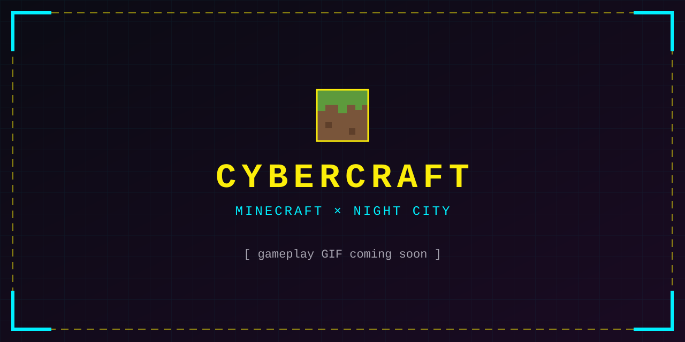
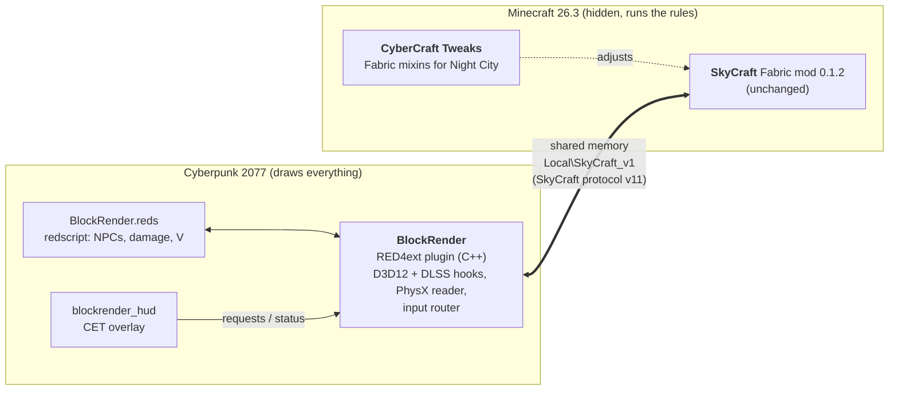

<div align="center">

<!-- Header GIF: replace header-placeholder.svg with the GIF (e.g. .github/assets/header.gif) when it's ready. -->


# CyberCraft

**Play Night City as a Minecraft player.**<br>
Place and break blocks on its streets, move with Minecraft's physics, fight its gangs with a diamond sword,<br>
and let your wolf follow you down the stairs of Megabuilding H10.

[](https://github.com/ItzBloxy/CyberCraft/releases)
[](https://github.com/ItzBloxy/CyberCraft/releases)
[](LICENSE)

[](https://www.cyberpunk.net/)
[](https://www.minecraft.net/)
[](https://fabricmc.net/)
[](https://github.com/WopsS/RED4ext)
[](https://github.com/chasmlol/SkyCraft)
[](#requirements)
[](#known-issues)

[**Install**](#installing) · [**Controls**](#controls) · [**How it works**](#how-it-works) · [**Troubleshooting**](#troubleshooting) · [**Build from source**](#building-from-source) · [**Credits**](#credits)

</div>

---

CyberCraft is [SkyCraft](https://github.com/chasmlol/SkyCraft) (Minecraft played inside Skyrim) brought to
Cyberpunk 2077. Neither game is rewritten. Minecraft runs hidden next to Cyberpunk and keeps its own game logic:
blocks, items, mobs, health and inventory. Cyberpunk keeps its world, NPCs, quests and saves, and draws everything you
see. The two talk over shared memory, using SkyCraft's own Minecraft mod, unchanged.

> [!WARNING]
> **Early and experimental.** CyberCraft grew out of nine research spikes, and it shows: the in-game panel is a
> developer overlay, and only one setup has been tested (see [Requirements](#requirements)). Back up your saves.
> CyberCraft is a fan project, not affiliated with Mojang, Microsoft or CD PROJEKT RED, and it ships none of their
> assets. You need to own both games.

## See it in action

<div align="center">

<!-- Showcase video: drag the .mp4 into this README while editing it on github.com, which uploads it and puts its link
     here, or link a YouTube video's thumbnail. Then delete the placeholder image below. -->


</div>

## What works

| | |
|---|---|
| 🧱 **Blocks in Night City** | Minecraft's blocks are drawn into the game's own frame: lit by its sun, street lights, ray-traced reflections and ambient occlusion, and upscaled by DLSS with the rest of the city. Glass, water, slime, honey, stained glass and ice are see-through, and grass and flowers are lit as the game's own plants. A block appears a frame or two after Minecraft places it. A 125-TNT blast doesn't drop a frame. |
| 🏃 **Build mode (F8)** | You move as Minecraft's player does: walk, sprint, jump, sneak and fly, at Minecraft's own speeds, with V's camera riding Minecraft's eye. Place and break blocks, scroll the hotbar and use any item. |
| 🧭 **Collision, both ways** | Minecraft gets Night City's shape, read from the game's physics, so its player stands on the streets, stairs and rooftops. Outside build mode, Minecraft's blocks stop V, cars and bullets, and NPCs walk around them. |
| ⚔️ **NPCs and combat** | Night City's people, drones and animals are in Minecraft's world, so they press pressure plates and take sword hits. Minecraft's hits go through the game's own damage pipeline, scaled by V's stats. The city's hits on V hurt Minecraft's player, and dying in Minecraft kills V. TNT knocks gangers flat. |
| 🐺 **Minecraft's mobs and entities** | Mobs, block entities (chests, beds, banners, heads), particles, dropped items, arrows and tridents are drawn where Minecraft has them, posed and animated. Spider eyes glow at night, and slimes and allays are see-through. |
| 🗺️ **Mobs that find their way** | Mobs wander the city's pavements and rooms, chase you, and follow wheat and dandelions. Pets keep up with V, even down stairwells. Walls block their line of sight, and railings count as fences. |
| 🎒 **Minecraft's screens** | The inventory, chests, crafting, chat, commands, the pause menu and F3+F4, worked with a cursor drawn over Night City. Typing works with any keyboard layout, AltGr and dead keys included. |
| 🏙️ **The city stays intact** | Night City's ground can't be dug, so Minecraft's copy of it can't either: blasts don't leave blocks floating in mid-air. |

## How it works



- **BlockRender** (`spikes/block-render/`) is the game side, playing the part of SkyCraft's Skyrim plugin. It draws
  the sections, entities and HUD that SkyCraft sends into the game's G-buffer, before DLSS. It reads Night City's
  geometry from the game's PhysX scene and sends it to Minecraft as collision. It routes keyboard and mouse to
  Minecraft in build mode, and moves V along with Minecraft's player.
- **BlockRender.reds** hooks the game's scripts: NPCs entering and leaving the world, damage both ways, and hiding V's
  body in build mode.
- **CyberCraft Tweaks** (`minecraft/cybercraft-tweaks/`) is a small Fabric mod next to SkyCraft. It turns off digging
  into the city, keeps entities' layers in Minecraft's draw order, marks glowing and blended layers, carries V's health
  into Minecraft, and teaches Minecraft's pathfinding about the city's shape.
- **SkyCraft's Fabric mod** does the heavy lifting on Minecraft's side, exactly as it does for Skyrim.

## Requirements

<table>
<tr><th>Cyberpunk 2077 side</th><th>Minecraft side</th></tr>
<tr valign="top"><td>

- **Cyberpunk 2077 2.31** (with or without Phantom Liberty)
- [**RED4ext**](https://www.nexusmods.com/cyberpunk2077/mods/2380) 1.30 or newer
- [**redscript**](https://www.nexusmods.com/cyberpunk2077/mods/1511)
- [**Cyber Engine Tweaks**](https://www.nexusmods.com/cyberpunk2077/mods/107), for the in-game panel
- [**Codeware**](https://www.nexusmods.com/cyberpunk2077/mods/7780), recommended: without it, V's own body
  stays visible in build mode

</td><td>

- **Minecraft: Java Edition** (an account that owns it)
- **Minecraft 26.3** with **Fabric Loader 0.19.5** or newer
- [**Fabric API**](https://modrinth.com/mod/fabric-api) for 26.3
- [**SkyCraft's Fabric mod, exactly 0.1.2**](https://github.com/chasmlol/SkyCraft/releases/tag/v0.1.2)
  (`skycraft-fabric-0.1.2.jar`)
- **CyberCraft Tweaks** (from this repo's [releases](https://github.com/ItzBloxy/CyberCraft/releases))
- **Java 21 or newer** (tested on 25); any launcher (tested with the Modrinth App)

</td></tr>
</table>

**Tested setup:** Windows 10, an NVIDIA GPU, Cyberpunk 2077 2.31 (Epic) at 2560 × 1440 with DLSS Quality, frame
generation and ray tracing. Steam and GOG copies of 2.31, other upscalers and AMD or Intel GPUs are untested.
BlockRender hooks the game's DLSS path through NVIDIA Streamline. Budget about 3 GB of extra RAM for Minecraft. Running
it costs Cyberpunk about 2 ms a frame.

> [!IMPORTANT]
> BlockRender reads the game's code and physics directly, so it's tied to game version **2.31**. A game patch can
> break it. If yours updated, check the [releases](https://github.com/ItzBloxy/CyberCraft/releases) for a matching
> build before playing.

## Installing

> [!TIP]
> Using an AI coding agent such as Claude Code or Codex? Point it at [`AGENTS.md`](AGENTS.md). It has the same steps
> with checks for each one, and can walk you through the install.

### 1. Install the game's mod frameworks

Install **RED4ext**, **redscript**, **Cyber Engine Tweaks** and **Codeware** (links under
[Requirements](#requirements)) with Vortex, MO2 or by hand. Start the game once to check that it reaches the main
menu, and when Cyber Engine Tweaks asks for an overlay key, bind it to **Shift + F6**. BlockRender knows that
combination: in build mode it opens the overlay instead of reaching Minecraft.

### 2. Install CyberCraft into the game

Download **`CyberCraft-<version>.zip`** from the [latest release](https://github.com/ItzBloxy/CyberCraft/releases).

- **Vortex:** drag the zip onto Vortex's *Mods* page, then enable and deploy it.
- **By hand:** extract the zip into your Cyberpunk 2077 folder (the one holding `bin` and `r6`), so its `red4ext` and
  `bin` folders merge with the game's.

You should end up with:

```text
Cyberpunk 2077/
├── red4ext/plugins/BlockRender/
│   ├── BlockRender.dll
│   ├── Scripts/BlockRender.reds
│   ├── shaders/blocks.hlsl
│   ├── make_atlas.bat          ← step 3
│   └── build_atlas.py
└── bin/x64/plugins/cyber_engine_tweaks/mods/blockrender_hud/init.lua
```

### 3. Build the block atlas from your own Minecraft

BlockRender needs Minecraft's block textures to draw with. They belong to Mojang, so the release doesn't include them.
You make them from your own copy:

1. Start **Minecraft 26.3** once in any launcher, so its game files are downloaded.
2. Double-click **`red4ext\plugins\BlockRender\make_atlas.bat`**.

It finds 26.3 in the official launcher's or the Modrinth App's folders and writes `atlas.bin` next to itself. It needs
[uv](https://docs.astral.sh/uv/) or Python 3; with plain Python, it installs Pillow first. With another launcher (Prism,
MultiMC, CurseForge), give it the 26.3 client jar from a command prompt:

```bat
make_atlas.bat "D:\path\to\26.3.jar"
```

### 4. Set up the Minecraft instance

In your launcher (the steps are for the [Modrinth App](https://modrinth.com/app); others are alike):

1. **Create an instance:** Minecraft **26.3**, loader **Fabric**.
2. **Add Fabric API** from the instance's *Content* tab.
3. **Add SkyCraft's mod:** download
   [`skycraft-fabric-0.1.2.jar`](https://github.com/chasmlol/SkyCraft/releases/download/v0.1.2/skycraft-fabric-0.1.2.jar)
   and drop it into the instance's `mods` folder (*⋯ → Open folder*). It has to be **0.1.2**: CyberCraft Tweaks
   targets its classes by name and won't load with another version.
4. **Add CyberCraft Tweaks:** download **`cybercraft-tweaks-<version>.jar`** from the
   [latest release](https://github.com/ItzBloxy/CyberCraft/releases) into the same `mods` folder.
5. **Set the Java arguments** (*Settings → Java and memory*):

   ```text
   --enable-native-access=ALL-UNNAMED -Dskycraft.quitWithSkyrim=false
   ```

   The first lets SkyCraft open the shared memory without Java's native-access warning. The second keeps Minecraft
   running when Cyberpunk closes; without it, Minecraft quits with the game, as SkyCraft's does with Skyrim.

Other mods are fine alongside, but keep resource packs off at first: a pack that changes mob textures can make
entities draw wrong in Night City.

### 5. Play

1. **Start Minecraft** from the instance and leave it on the **title screen**. Don't leave a menu such as *Options*
   open: SkyCraft waits for it to close.
2. **Start Cyberpunk 2077** and load a save.
3. **Press F8.** BlockRender links to Minecraft and turns on build mode. Minecraft hides its window, opens (or creates)
   its `SkyCraft` world, and your hotbar appears over Night City. You can also link first with the **Link** button in
   the overlay's *BlockRender* window.
4. Press **F8** again to go back to being V. Your blocks stay.

> [!NOTE]
> **Load your save straight after starting the game.** Loading a second save in a running game moves the city's
> physics where BlockRender doesn't look yet, so Minecraft loses the city's collision until you restart the game.

## Controls

| Key | Outside build mode | In build mode |
|---|---|---|
| **F8** | Link (if needed) and enter build mode | Leave build mode, closing any open Minecraft screen |
| **W A S D**, **Space**, **Left Shift**, **Left Ctrl** | The game's | Minecraft's movement, with Minecraft's own key bindings |
| **Mouse buttons** (side buttons too), **wheel** | The game's | Minecraft: break, use and place, hotbar |
| **1 – 9** | The game's | Minecraft's hotbar |
| **E** / **T** / **/** | The game's | Minecraft's inventory / chat / command line |
| **O** | The game's | Minecraft's pause menu (SkyCraft's settings are at its top left) |
| **Q** | The game's | Minecraft: drop the held item |
| **F3** (+ F4, N, …) | The game's | Minecraft's debug keys and the game-mode switcher |
| **Esc**, **I**, **M**, **J**, **P**, **K**, **H** | The game's menus | Leave build mode and open the game's menu. With a Minecraft screen open, Esc closes it instead |
| **Shift + F6** | Cyber Engine Tweaks' overlay | The overlay, with build mode paused while it's open |

In build mode, **F**, **R**, **Tab** and **F5** stay the game's. **C** does nothing, so V can't crouch under
Minecraft's player. While a Minecraft screen is open, every key is Minecraft's except F8 and Shift + F6.

### The in-game panel

Open Cyber Engine Tweaks' overlay (**Shift + F6**) to find the **BlockRender** window: what's linked, what's on, and
where V stands in Minecraft's world. Its top row of buttons:

| Button | Does |
|---|---|
| **Link / Unlink** | Connect to Minecraft, or let go of it. Your blocks stay |
| **Blocks** | Minecraft's blocks stop V, cars and bullets (on by default) |
| **Turn** | Build mode's mouse turning (on by default) |
| **NPCs** | Night City's NPCs in Minecraft's world (on by default) |
| **Combat** | Minecraft's hits land on NPCs, and the city's hits on V go to Minecraft (**off** by default) |
| **Entities** | Draw Minecraft's mobs, items and particles |

The folded sections hold the rest. **Fun** has buttons for creative and survival, items for your hands, armor and a
heal, and mobs, particles and TNT to spawn in front of you. **More controls** and **Full status** are developer tools.

## Uninstalling

- **Game:** remove the mod in Vortex, or delete `red4ext\plugins\BlockRender` and
  `bin\x64\plugins\cyber_engine_tweaks\mods\blockrender_hud`. BlockRender adds nothing to your saves.
- **Minecraft:** delete the instance, or just the two jars. Your builds live in the instance's `saves\SkyCraft` world.

## Troubleshooting

| Problem | What to do |
|---|---|
| The panel says *there's no atlas.bin in the plugin's folder* | Run `make_atlas.bat` ([step 3](#3-build-the-block-atlas-from-your-own-minecraft)). |
| Nothing links; the panel's mapping state never opens | Check that Minecraft is running with SkyCraft 0.1.2 and is on its title screen with no menu open. Its lines starting `SkyCraft:` in Minecraft's `logs\latest.log` say how the link is going. |
| Minecraft won't start: *Incompatible mods* | CyberCraft Tweaks needs exactly SkyCraft **0.1.2**, Minecraft **26.3** and Fabric API. |
| Minecraft's player falls through the city, or *V's controller isn't found* | You loaded a save in an already-running game. Restart Cyberpunk and load directly. |
| Mobs look wrong (stretched or mismatched textures) | Turn off resource packs that change entity textures, then restart Minecraft. |
| BlockRender doesn't load at all | Check `red4ext\logs\red4ext-*.log` for `BlockRender (version: …) has been loaded`. If it's missing, your game version probably isn't 2.31. |
| Something else | BlockRender logs to `red4ext\logs\blockrender-*.log`, its scripts to `r6\logs\redscript_rCURRENT.log`, and the panel's *Full status* shows every status line. Open an [issue](https://github.com/ItzBloxy/CyberCraft/issues) with them. |

### Known issues

- **Saving Minecraft:** Minecraft autosaves every 5 minutes, but its pause menu doesn't save while linked. Stopping it
  from the launcher's *Stop* button kills it unsaved, so wait for an autosave first.
- **Doorways:** after V moves, SkyCraft can lift Minecraft's player onto anything within 2.5 blocks above its feet,
  such as a doorway's frame. Wide mobs (cows, pigs) don't fit some of the city's doors.
- **Fast building:** one GPU hang (`DXGI_ERROR_DEVICE_HUNG`) was seen while placing blocks very fast, and its cause
  isn't settled. To help find it, put `dred = 1` in `red4ext\plugins\BlockRender\settings.txt`; BlockRender then logs
  what the GPU was doing if it happens.
- **Not drawn yet:** signs' and name tags' text, and the scrolling of a breeze's wind and a charged creeper's swirl.
- **See-through blocks** (water, stained glass, slime, honey, ice) are lit by Minecraft's light rather than the
  game's, so they may look too bright at night, and the city's haze doesn't fall on them.
- **Single player:** only Minecraft's world can be shared, through SkyCraft's own multiplayer, and that's untested
  here.

## Building from source

```bash
git clone --recursive https://github.com/ItzBloxy/CyberCraft.git
```

**BlockRender** needs Visual Studio 2022 (*Desktop development with C++*) and CMake 3.25 or newer:

```bash
cd spikes/block-render
cmake --preset default
cmake --build --preset release
ctest --preset release
```

Add `-DCP2077_DIR="E:/Cyberpunk2077"` to the first command to have each build copy the plugin, its script, shader and
the overlay into the game; build with the game closed. `tools/mclink` builds `mclink`, a console stand-in for the game
that runs the scripts in `tools/mclink/*.txt` against a real Minecraft.

**CyberCraft Tweaks** needs a JDK 21 or newer and Git Bash. It compiles against the jars the Modrinth App keeps for an
instance named `CyberCraft`, so there's no Gradle and nothing to download:

```bash
cd minecraft/cybercraft-tweaks
bash build.sh    # build/cybercraft-tweaks-<version>.jar
bash test.sh     # the pathfinding rules' unit tests
bash mixins.sh   # checks every mixin's target against Minecraft 26.3's jar
```

**A release** is packed by `release/package.py` from the two builds:

```bash
python release/package.py spikes/block-render/build/RelWithDebInfo minecraft/cybercraft-tweaks/build/cybercraft-tweaks-1.7.1.jar 0.1.0
```

## Repository layout

| Path | What's there |
|---|---|
| [`spikes/block-render/`](spikes/block-render) | **BlockRender**: the RED4ext plugin, its redscript, shader, CET overlay, `mclink` and 563 unit tests |
| [`minecraft/cybercraft-tweaks/`](minecraft/cybercraft-tweaks) | **CyberCraft Tweaks**: the Fabric mod, with [its own README](minecraft/cybercraft-tweaks/README.md) |
| [`spikes/physx-probe/`](spikes/physx-probe) | Spike 1's probe: can the game's PhysX be read through NVIDIA's public headers? |
| [`docs/superpowers/specs/`](docs/superpowers/specs) | The design of each spike |
| [`docs/superpowers/plans/`](docs/superpowers/plans) | Their implementation plans, task by task |
| [`docs/spikes/`](docs/spikes) | What each spike found in the game, with its answer at the top |
| [`extern/`](extern) | RED4ext.SDK (a submodule), PhysX 3.4 and Streamline public headers, SkyCraft's protocol header |
| [`release/`](release) | The release's atlas script and packer |
| [`tools/plans/`](tools/plans) | Scripts used while planning (the PhysX ABI audit, path simulations) |

### How it was built

CyberCraft was built in nine spikes, each asking one question, answering it in the game, and writing the answer down:

| # | Question | Answer |
|---|---|---|
| 1 | Can the game's PhysX scene be read? | Yes: its PhysX 3.4 differs from NVIDIA's public headers in one virtual slot |
| 2 | Can V be puppeted every frame? | Folded into spike 5 |
| 3 | Can blocks be drawn into the game's frame? | Yes, lit by the game, before DLSS |
| 4 | Can Night City show Minecraft's live world through SkyCraft? | Yes, a frame after Minecraft changes it |
| 5 | Can Minecraft's player drive V, and blocks stop V? | Yes, both |
| 6 | NPCs in Minecraft, and combat both ways? | Yes, through the game's own damage pipeline |
| 7 | Can Minecraft's entities be drawn? | Yes: mobs, block entities, particles, items |
| 8 | Can Minecraft's screens be worked from the game? | Yes, with a cursor and any keyboard layout |
| 9 | Can mobs find their way on the city's ground? | Yes, with CyberCraft Tweaks 1.7.1 |

The specs, plans and results in [`docs/`](docs) record every step, measurement and dead end. CyberCraft was developed
with [Claude Code](https://claude.com/claude-code).

## Credits

- **[SkyCraft](https://github.com/chasmlol/SkyCraft)** by **chasmlol**: the original Minecraft-in-Skyrim mod, and
  CyberCraft's foundation. Its Fabric mod runs Minecraft's side unchanged, and its protocol is the link. CyberCraft
  exists because SkyCraft showed how.
- **[RED4ext](https://github.com/WopsS/RED4ext)** and **[RED4ext.SDK](https://github.com/WopsS/RED4ext.SDK)** by WopsS
- **[redscript](https://github.com/jac3km4/redscript)** by jac3km4
- **[Cyber Engine Tweaks](https://github.com/maximegmd/CyberEngineTweaks)** by yamashi and its team
- **[Codeware](https://github.com/psiberx/cp2077-codeware)** by psiberx
- **[Fabric](https://fabricmc.net/)**, **NVIDIA** for the PhysX 3.4 and Streamline public headers, and
  [universal-modder](https://github.com/rehan-remade/universal-modder) for describing the mashup pattern

## License

CyberCraft is under the [MIT License, with attribution](LICENSE). Use it, fork it, build on it. Anything you publish
that contains or derives from CyberCraft has to credit **SkyCraft** and **CyberCraft** where its users will see it. The
code in [`extern/`](extern) keeps its own licenses.

<div align="center">
<sub>Minecraft is a trademark of Mojang Synergies AB. Cyberpunk 2077 is a trademark of CD PROJEKT S.A.<br>
CyberCraft is an unofficial fan project.</sub>
</div>
