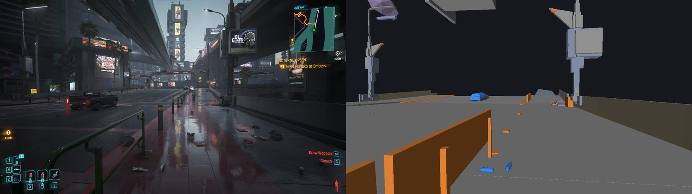
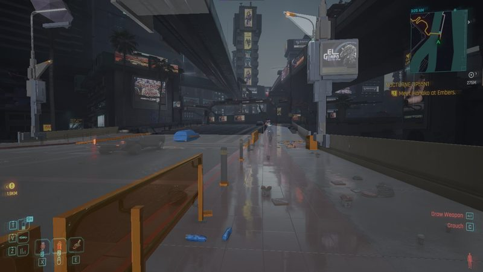
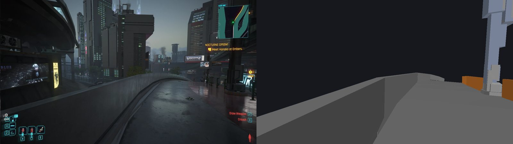
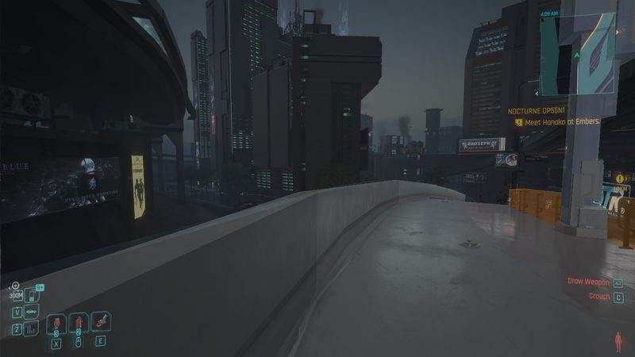
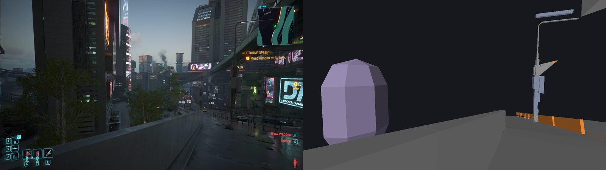
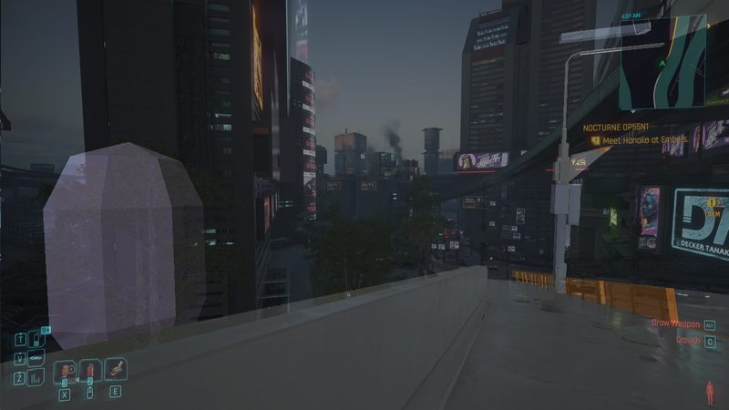

# PhysX probe: in-game results

Date: 2026-10-01. Game: Cyberpunk 2077 2.31 (Epic). Probe 0.2.0 (plan Tasks 16 to 21) and 0.3.0 (a locator added
during Task 22, see "Coordinates"). The user played; the agent triggered dumps through `dump.request` and read the
reports.

## Verdict

**Pass, with one finding that shapes the collision exporter:**
- **Reading the game's PhysX works.** The probe reads the city's physics world through NVIDIA's 3.4.2 headers,
  corrected by the audit, with no faults and nothing skipped.
- **PhysX coordinates are not world coordinates.** The game keeps PhysX's origin on a 1,024 m grid near V, so a reader
  must subtract that origin.
- **All four criteria pass with the origin applied,** at three spots in the city.

## Revision 1

Revision 1's first runs found three things. The audit, [2026-10-01-physx-abi-audit.md](2026-10-01-physx-abi-audit.md),
has the details.
- **The version field:** NVIDIA's 3.4.2 release keeps 3.4.1.0 in the binary FILEVERSION field. Only the
  "FileVersion" string says 3.4.2.0.
- **The `PxShape` slot shift:** the game's `PxShape` has one more virtual function than NVIDIA's headers, so every
  `PxShape` call from slot 6 on ran the next function, several of them setters.
- **The crash handler:** the game's handler sees a fault before any `__try/__except`. Revision 1's guard turned the
  resulting fault into a frozen game.

Revision 2 corrects the header, checks each object's vtable against the audited build before calling anything on it,
and catches nothing.

## Pass criteria

The startup world is the stand-in player's world at the main menu. The others are free roam in Downtown, along one
sidewalk and the raised walkway south of it.

| Criterion | Startup world | Free roam, first try | Spot B | Ramp | Past the line |
|---|---|---|---|---|---|
| Dump | `13-34-03` | `13-41-08` | `14-37-07` | `14-46-55` | `14-50-33` |
| V's feet (world) | (0.0, 3.6, 0.0) | (−191.7, 691.6, 77.5) | (−189.9, 616.8, 74.4) | (−178.1, 550.0, 74.1) | (−197.2, 505.8, 68.2) |
| Origin used | none | none | (0, 1024, 0) | (0, 1024, 0) | none (it is 0 here) |
| 1. Compatibility | ✅ 7/7, 0 skipped, 0 mismatches | ✅ 7/7, 0, 0 | ✅ 7/7, 0, 0 | ✅ 7/7, 0, 0 | ✅ 7/7, 0, 0 |
| 2. Coordinate check | ✅ 1.800 m | ❌ no hit | ✅ 1.800 m | ✅ 1.800 m | ✅ 1.808 m |
| 3. Render matches the screenshot | not checked (menu) | ❌ nothing to render | ✅ | ✅ | ✅ |
| 4. Timings present | ✅ | ✅ | ✅ | ✅ | ✅ |

The first free-roam try failed criteria 2 and 3 because the origin was not yet known. The same thing happens with
every plain dump north of y = 512: `14-34-55`, `14-46-37` and `14-49-29` all found no ground under V.

## Compatibility steps

From the first free-roam dump (`13-41-08`):

1. **Build:** `PhysX3_x64.dll` timestamp 0x64c978b4, image size 0x281000; `PhysX3Common_x64.dll` timestamp
   0x64c978a8, image size 0x1f9000; `PhysX3_x64.dll` FileVersion "3.4.2.0" (binary field 3.4.1.0).
2. **Physics:** `PxPhysics` at 0x208c0181380, an audited `PxPhysics` vtable.
3. **Tolerances:** length 1, speed 10 (PhysX's defaults).
4. **Scenes:** 15.
5. **Gravity and counts:** gravity (0, 0, −9.81) in every scene; 5,781 actors in scene 0 and 5 in each of the others.
6. **Objects:** 2,090 objects checked, including at least one triangle mesh, one heightfield and one convex mesh.
7. **Geometry and meshes:** every checked mesh matches its shape.

Every live object the probe met in 13 city dumps, meshes included, had an audited vtable and the matching type ID.

## Scenes

- **Count:** 15 in the first session, 7 or 8 in the second. Scene 0 is the world. The others are copies of a small
  scene, each holding 5 static planes and nothing else (flags 0x1, active actors only), and their number changes over
  time.
- **Scene 0's flags:** 0x2021d. That's active actors, CCD (without resweep), adaptive force, PCM, and kinematics left
  out of the active actors.
- **The read-write lock:** `eREQUIRE_RW_LOCK` is off in every scene, in the startup world and in the city.

| Scene 0 | `13-41-08` | `14-37-07` |
|---|---|---|
| Static actors | 4,865 | 3,749 |
| Dynamic actors | 916 | 875 |
| Aggregates (actors in them) | 9 (112) | 14 (121) |
| Articulations | 0 | 0 |
| Census time | 7.8 ms | 11.2 ms |

## What's in the collision

Scene 0 at `13-41-08`:
- **By geometry:**

  | Geometry | Shapes |
  |---|---|
  | Box | 3,102 |
  | Triangle mesh | 3,046 |
  | Convex mesh | 814 |
  | Capsule | 467 |
  | Sphere | 161 |
  | Heightfield | 5 |
  | Plane | 1 |
- **By flags:** 7,397 scene-query shapes, 7,270 simulation shapes and 7 triggers, out of 7,596 shapes.
- **Query filters** (`w0:w1:w2:w3`, 31 distinct): 0:0:449c004:0 (3,848), 0:0:405c004:0 (966), 0:0:480000:0 (963),
  0:0:42dc108:0 (342), 0:0:4000:0 (236), 0:0:4498008:0 (184), 0:0:400000:0 (172), 0:0:200000:0 (128),
  0:0:600010:0 (119), 0:0:4680000:0 (110).
- **Simulation filters** (33 distinct): 5c004:0:13ce:0 (3,848), 0:0:0:0 (1,338), 5c004:0:1e48:0 (966),
  1c008:0:5c4b:0 (340), 4000:0:0:0 (235), 1c008:0:13cf:80000000 (184), 10:0:8ce0:80000000 (128), 0:0:144a:0 (110),
  4040:0:2fd:80000000 (85), 18000:0:11fe:80000000 (70).
- **Names:** no actor has a PhysX name. `userData` is set on 5,780 of the 5,781 actors (pointing at game objects).
- **Capsules on dynamic actors** (`14-37-07`): 366, of which 245 are kinematic.

## Region cost

The region is ±32 m around V horizontally, and from 16 m below V's feet to 32 m above.

| | Spot B | Ramp | Past the line |
|---|---|---|---|
| Actors selected by bounds | 504 | 200 | 232 |
| Overlap hits (shapes) | 773 | 301 | 381 |
| Triangles | 76,654 | 23,426 | 21,080 |
| Select / overlap / extract | 0.52 / 0.23 / 6.55 ms | 0.35 / 0.15 / 2.64 ms | 0.51 / 0.17 / 2.05 ms |
| Main-thread pause | 45.0 ms | 39.0 ms | 37.1 ms |

Spot B's triangles by category:

| Category | Triangles |
|---|---|
| Static triangle mesh | 41,618 |
| Static heightfield | 19,785 |
| Kinematic capsule | 3,648 |
| Dynamic convex | 3,120 |
| Dynamic capsule | 2,048 |
| Static convex | 1,713 |
| Dynamic box | 1,428 |
| Kinematic box | 1,068 |
| Static box | 992 |
| Kinematic convex | 902 |
| Query-only capsule | 128 |
| Kinematic triangle mesh | 72 |
| Static capsule | 64 |
| Query-only sphere | 48 |
| Static sphere | 20 |

The census and region work account for 8 to 19 ms of each 30 to 55 ms pause in the city. The report doesn't break
down the rest: the compatibility check's sampling, and the locks and rays of 7 to 15 scenes.

## Coordinates

- **The ray:** where the origin was right, the ray down from 1.8 m above V's feet hit at 1.800, 1.800, 1.800 and
  1.808 m.
- **The origin:** the 0.3.0 locator recorded every capsule on a dynamic actor. Between two dumps 52 m apart, exactly two
  capsules moved as V did, both with an error of 0.000 m and with no axis swap or mirror.
  - **V's controller** is a kinematic capsule with radius 0.32 and half-height 0.4, query filter 0:0:2000:0 and
    simulation filter 1:0:41ce:0. Its centre is exactly 1 m above V's feet.
  - **The other one,** with radius 1.0 and query filter 0:0:400001:0, encloses V. The startup world has it too.
  - **The offset:** in all ten 0.3.0 dumps between y = 520 and y = 685, V's feet minus the controller's centre was
    exactly (0, 1024, −1). At y = 505.8 it was (0, 0, −1).
- **The rule this fits:** PhysX coordinates = world − origin, and the origin is the multiple of 1,024 m nearest V. It
  switched within 6 m of y = 512.
  - **Seen:** only the Y switch. V stayed near x = −190 and z = 70.
  - **Open:** whether X and Z switch the same way, and whether there's hysteresis on the way back north.
- **The field of view:** the camera's reported 68.24° is the vertical field of view. Renders with the default
  `--fov-axis v` match the screenshots; `h` is visibly too narrow.

Spot B, the screenshot beside the render, then blended 50/50:

The ramp:

Past the line, where a plain dump needs no origin:

In the renders, grey is static, blue dynamic and orange kinematic. Traffic moved between the spot B screenshot and its
re-check dump, so its car doesn't line up. The dumps are in `E:\Cyberpunk2077\red4ext\plugins\PhysXProbe\dumps\`,
under the names in the tables.

## Surprises and next steps

1. **The origin moves with V,** on a 1,024 m grid. The exporter has to read PhysX at world − origin and know the
   origin at every export.
   - **Where to get it:** V's own controller gives it without touching game internals: feet minus controller centre,
     rounded to multiples of 1,024 m.
   - **Still open:** the X and Z switches, hysteresis, and whether the switch can land between the exporter's reads.
2. **Character controllers aren't world collision.**
   - **For the exporter:** leave kinematic capsules out. V's own two enclose the camera.
   - **For the renderer:** it now hides them by default (`9d7a558`).
3. **Only scene 0 matters.** The small five-plane scenes come and go.
4. **No threading trouble showed:** 0 skipped objects in 13 city dumps, without the read-write lock.
5. **The city has heightfields.** At spot B, 19,785 of 76,654 triangles were heightfield, from the planted area beside
   the walkway.
6. **Collision is coarse in places.** A tree is one convex shape around its canopy, and litter is dynamic capsules.
7. **A dump pauses the main thread for 30 to 55 ms.** That's fine for a probe, but not every frame. The census of all
   actors (8 to 15 ms) costs more than the region work (under 8 ms). An exporter should walk only the region,
   and spread the work over frames.
8. **The error reporter isn't a crash sign.** `REDEngineErrorReporter.exe` starts with the game, 3 seconds after it,
   so seeing it running doesn't mean the game crashed.
