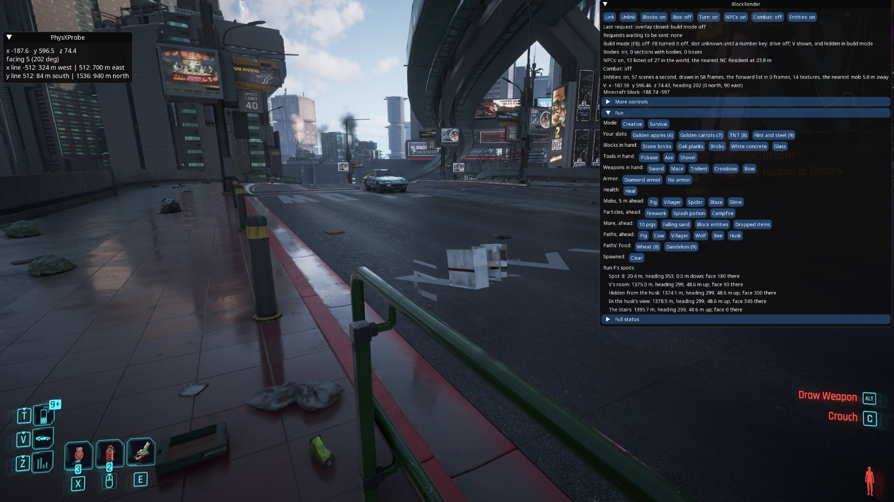
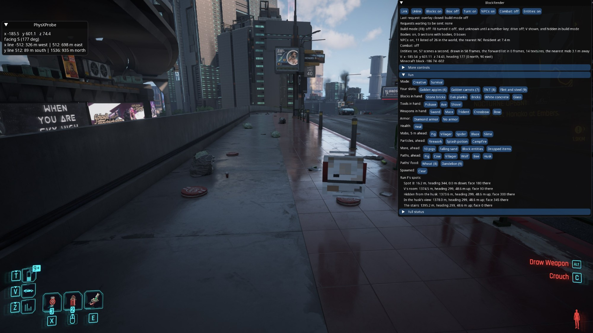

# Minecraft's mobs finding their way in Night City: results

Spike 9 makes Minecraft's mobs find their way on Night City's ground
([the spec](../superpowers/specs/2026-10-08-minecraft-paths-design.md)): wander, go to targets, keep up with their
owner as pets, fly around the city's walls, and not see V through them, from CyberCraft Tweaks 1.7.0 and then 1.7.1.
Step 0 checks Minecraft's side with `mclink`, without the game: first with 1.6.0 as the control, then with 1.7.0, then
with 1.7.1, which fixes what the 1.7.0 run found. Run F checks it in the game.

## The answer

> Can Minecraft's mobs find their way over Night City's ground as they do over blocks: wander, go to what they're
> after, keep up with V as pets, and fly around its walls, without seeing V through them?

**Yes,** with CyberCraft Tweaks 1.7.1, in Minecraft against the city's dumps (step 0, then the Paths rows with
`mclink`) and in the game (run F, at spot B and in V's apartment in Megabuilding H10):
- **They wander** the city's streets, pavements and rooms, among its furniture, stepping its kerbs and stairs, out of
  its walls and off its drops. Railings and the road's barrier are fences, so no mob walks onto them; a wall top 2
  blocks wide stays walkable, as a Minecraft wall's is.
- **They go to what they're after:** a cow followed the wheat 50 m across a street, a bee the dandelion through a
  doorway and down a stairwell, and a husk chased V.
- **Pets keep up:** a wolf followed V by path out of her front door, along the corridor and down the stairs, and
  whenever V outran it, landed beside her on her own storey, on the floor: 26 landings of 26 in step 0, 3 in the
  rehearsal, 21 at spot B and 14 in the apartment, never below a road or on a wrong storey.
- **Flyers go around walls:** the bee flew over the road's barrier (the rehearsal) and around door frames, its straight-line shortcuts cut
  short by the city's walls (536 of one minute's 566 in V's room).
- **Walls block sight:** a husk in the corridor behind V's wall, with a way round through the door, didn't come for V
  in 38 s (86 sight casts, all 86 hitting the city), and reached her within 4 s of her stepping into view; step 0's
  skeleton didn't shoot V behind the road's edge until V stood in view.
- **Cost:** the frame rate didn't change (65 fps in the apartment with five mobs about, as with none); the casts took
  at most 41.5 ms a minute, on Minecraft's server thread.

**Solved since:** **mobs' textures drawn wrong** at some angles and distances, which the user called critical (on every
mob, they said after run F), was the user's VanillaTweaks resource pack (`VanillaTweaks_r318972_MC26.3.x.zip`),
loaded in every Minecraft session of spike 9. The user deleted it on 2026-10-09, and entities draw right again. It was
neither spike 7's drawing nor the user's mods (Entity Model, Texture and Sound Features are enabled again); the
handoff (`docs/superpowers/handoffs/2026-10-09-entity-texture-bug.md`) has the details.

**Left for later, none of them spike 9's mod:**
- **a save loaded in a running game** moves the city into another PhysX scene (scene 6 of 12), and BlockRender's
  exporter reads scene 0 only: no city, and no build mode, until the game restarts. It should read the scene holding
  V's controller;
- **SkyCraft lifts Minecraft's player onto a doorway's header** when V stands under one within 2.5 blocks of her feet
  (`SkyClient.liftOutOfGeometry`), out of mobs' reach;
- **mobs 0.9 wide (cows, pigs) don't fit a doorway** the city's voxels leave 0.875 open, though their paths plan
  through it (the spec's risk 4, the 1/8-block voxels' coarseness).

## Step 0's control: CyberCraft Tweaks 1.6.0

Date: 2026-10-08. No Cyberpunk: `mclink` placed spike 1's raised-level dump (`2026-10-01_14-37-07`, 64,192 static
triangles) around 1280.5 6.14 2007.5 as Night City's ground, linked to the user's Minecraft with SkyCraft's unchanged
mod, and ran step 0's script, `spikes/block-render/tools/mclink/paths.txt`. The versions:
- **Minecraft 26.3**, Fabric Loader 0.19.5, Fabric API 0.161.0, in the Modrinth App's `CyberCraft` instance, with
  CyberCraft Tweaks **1.6.0** and the user's Entity Model Features and Entity Texture Features (left enabled, by the
  user's choice: they change how entities are drawn, not where they walk);
- **SkyCraft 0.1.2**, the release jar, protocol version 11;
- **`mclink`** from BlockRender's build on `main`, unchanged by this spike.

Plan: [2026-10-08-minecraft-paths.md](../superpowers/plans/2026-10-08-minecraft-paths.md), Task 8. The user started
Minecraft; the agent ran the script and read its output and Minecraft's log. Minecraft opened its world, `SkyCraft`,
by itself as the link came up, and the script took 168 s.

### Two things fixed before the run that counts

The first run (15:02) went to its end, cleared everything and put the game mode back, but two of its checks didn't
test anything:
- **The skeleton was never summoned.** Its command, with its bow, unbreakable helmet and drop chances, was 298
  characters, and `mclink`'s typer refuses more than Minecraft's 256-character chat line (`line 115: a command is at
  most 256 characters`). Written with Minecraft's default namespace and count it's 222 (`5ff4610`). The script's parse
  check couldn't see it: the typer checks a command's length only as it types it.
- **The wheat and the dandelion never reached the player:** its off hand held a shield, and the script fills the off
  hand only if it's empty, so no `Replaced 1 slot(s)` line came. The tempt and flyer checks failed for that alone. The
  user chose to move the shield themselves; Minecraft's window stays hidden after a link (SkyCraft hides it and doesn't
  show it again), and opening the world by hand would load the player over the void with no city's ground, so a short
  guarded `mclink` script moved it to empty inventory slot 15 instead, with the user's leave: copied only into an empty
  slot, the off hand emptied only once the slot held the shield (`Test passed. Count: 1`, then the off hand's `Test
  failed`). A reverse script puts it back after the 1.7.0 run.

Both runs' wander, pet and chase checks agreed.

### The run (15:16)

`exit: 0`; no `WARN` line and no command error in Minecraft's log. 26.3 words `/execute if`'s replies `Test passed.
Count: 1` and `Test failed`.

| Check | With 1.6.0 |
|---|---|
| Wander | the pig, the cow and the villager never moved: all 39 positions (13 each, every 5 s for 60 s) exactly where they were summoned (1272.5 6.0 2007.5, 2012.5, 2002.5); all three `OnGround` |
| Tempt | wheat in the off hand (`Replaced 1 slot(s) on ItzBloxy with [Wheat]`); `Test failed`, the cow still at 1278.5 6.0 2009.5 after V walked 10.5 blocks south |
| Pet | `Test failed` after V walked about 15 blocks south, and again after V's jump 21 blocks north: the wolf never left 1274.5 6.0 2007.5, never teleported; `OnGround` |
| Chase | `Test failed`, the husk still at 1276.5 6.0 2017.5 after 10 s in survival |
| Sight | the skeleton, hidden from V on the road behind the barrier and the road's edge, **shot anyway**: 3 arrows in the first scene's world records, 4 in the second (V on the ledge, in view); `/kill` took the 4 left |
| Flyer | the bee flew toward V on the ledge and **stuck against the barrier**, at 1284.6 6.25 2007.65, where it still was 8 s after V went down onto the slope; `Test failed` |
| Clear | the last scene `world: nothing`; the dandelion taken from the off hand, the effects cleared, survival set back (the user's mode, from the scoreboard) |

So without the mod nothing walks, follows, teleports or chases on Night City's ground, a mob sees through it, and a
flyer flies into it: every check can tell.

## Step 0 with CyberCraft Tweaks 1.7.0: the first run

Date: 2026-10-08, 22:02. The same script and ground, CyberCraft Tweaks **1.7.0** installed (Minecraft stopped, 1.6.0
renamed `.jar.disabled`), `- cybercraft_tweaks 1.7.0` in Minecraft's log with no mixin error before or after the run.
`exit: 0`. Plan: Task 9.

### A stale save first

The control's session had ended with no "Saving" line: stopping Minecraft from the Modrinth App had killed it unsaved,
so this session loaded its last autosave, taken during the control's pet check (15:17:52 to 15:18:12). It held the
control's scoreboard objective (`An objective already exists by that name`), the player in creative (so the script
noted creative, and set creative at the end), wheat already in the off hand (so the script's guarded `item replace`
didn't run, and the tempt still had its wheat), and **the control's own test wolf**, tamed by its `Owner`, standing on
the city's ground. As the world loaded, before the link brought the ground, that wolf fell; 1.7.0 teleported it to
its owner onto the city's floor (the first minute line's `1 pets landed`) while it was falling, and it died of the
fall (`Wolf fell from a high place`, 22:02:53): a pet's landing keeps its fall distance. No other test entity was in
the autosave. From here on, Minecraft is saved (`/save-all flush`) before it's stopped.

### The checks

| Check | With 1.7.0 |
|---|---|
| Wander | the pig strolled 6 times and went 18.6 blocks, at y 6.0 to 6.25; the cow strolled once, 7.3 blocks, and then stood 55 s; the villager went 26.5 blocks, **up onto the barrier's top** (1283.1 7.5 1989.5) and **off its far side** to y 1.75, below the road, where it stayed |
| Tempt | `Test passed. Count: 1`, the cow at 1279.5 6.0 2016.1 beside V |
| Pet | `Test passed. Count: 1` after the walk (the wolf at 1276.2 6.0 2021.2, V at 2022.7); after the jump north, `Test failed`: the wolf at 1281.3 **3.795** 1997.6, in the air, under the road deck |
| Chase | `Test passed. Count: 1` |
| Sight | the first scene, V on the road: no arrow; the second, V on the ledge in view: an arrow. The minute lines count 41 and 20 sight casts hitting the city |
| Flyer | `Test passed. Count: 1`, the bee at 1289.5 −0.875 2007.1 on the slope, past the barrier and down the rock face |
| Cost | three minute lines: 74,993, 16,465 and 8,429 city answers; 2,948, 238 and 140 shapes classified; 19, 277 and 179 sight casts; 12 shortcut casts (the bee's, none hit); **0.6, 2.3 and 1.9 ms casting a minute** |
| Clear | `world: nothing`; the dandelion taken back; the game mode set to creative, as the stale save had it |

### Diagnostics

With the user's leave, four short `mclink` scripts (`build/step0/diag1` to `diag4`) watched pets and mobs every tenth
of a second to a second. Each moved the stand-in V before its `dump`, and a dump goes around V's feet as `dump` runs,
so each built **a shifted copy of the city** (diagnostic 2's by −4, −0.14, −7): their positions are read through that
shift.
- **Teleports** (diagnostic 1): three jumps of V, 22 blocks each way; the wolf landed on the road every time
  (1273.5 6.125 2000.5, 1279.5 6.125 2022.5, 1275.3 6.125 2002.6), on the ground, and stayed or strolled there. Step 0's
  one wolf under the road stays unexplained.
- **The barrier** (diagnostic 2): of two villagers and a pig, one villager climbed onto the barrier's top (its 7.375
  is the barrier's 7.5 through the shift) and fell off its far side to −0.4; the other, summoned onto the narrow ledge
  behind the barrier, walked off its edge down the rock face; the pig stayed on the road.
- **Kerbs and slopes** (diagnostics 3 and 4): cows tempted across a kerb and up the sloped pavement, sampled every
  tenth of a second (804 samples), never left the ground's surface.

### What it means

- **Thin tops are walkways.** The barrier, a skin 1/8 block thick and about 1.25 m tall, counts as a full block with
  a floor on top (its top part is even a floor cell, its lower half-block of skin), so mobs path onto it, along it and
  off its far side, and the narrow ledge behind it drops them further. The user chose to make such cells **fences**.
- **A pet's landing must reset its fall distance.**
- **The script summons inside a skin** where it gives the pavement's y 6.2 (its skin spans 6.125 to 6.25): such a mob
  falls through the skin it's inside. Summons go half a block above the floor, to drop onto it.

### Fixed in 1.7.1

Plan Tasks 10 to 13: thin cells are fences (`CellRule.THIN`); a pet's landing resets its fall distance; step 0's
summons go half a block above their floors, with a second wandering villager beside the barrier; and a new script,
`tools/mclink/teleports.txt`, makes five jumps with a pet wolf. The scripts were meant to end with `/save-all flush`,
but singleplayer has no such command (26.3 registers it on dedicated servers only), and the pause menu doesn't save a
linked game either. What saves the world is Minecraft's autosave, every 5 minutes, which writes `level.dat` and the
player's file in `players/data/`. So before Minecraft is stopped, one autosave must pass after the last script.

## Step 0 with CyberCraft Tweaks 1.7.1

Date: 2026-10-08, 22:48. Minecraft stopped after an autosave (22:42:51) that followed the last diagnostic; 1.7.0
renamed `.jar.disabled`, 1.7.1 installed; `- cybercraft_tweaks 1.7.1` in Minecraft's log, no mixin error. Plan:
Task 14. Minecraft's only warnings were the two render ones at link-up, `Couldn't acquire next surface texture` and
`Requested post effect does not exist: minecraft:end_of_frame`, which the 1.7.0 run after a fresh start had too.

### The checks

`exit: 0`, 170 s.

| Check | With 1.7.1 |
|---|---|
| Wander | all four mobs strolled, every one of their 52 positions at y 6.0 to 6.375, all four `OnGround` `1b`: the pig moved between 9 of its 13 samples and ended 13.4 blocks from its start; the cow 9 times, 13.0 blocks; the street's villager 4 times, 6.3 blocks; the villager by the barrier 7 times, 7.9 blocks, down the kerb onto the street, back, and north to 1282.5 6.375 1987.7, where the road climbs. None on the barrier's top, none below the road |
| Tempt | `Test passed. Count: 1`, the cow at 1279.6 6.25 2016.3 beside V |
| Pet | `Test passed. Count: 1` after the walk (the wolf at 1276.2 6.0 2021.2, the same position to the last digit as with 1.7.0); after the jump north, `Test passed. Count: 1`, the wolf landed at 1278.5 6.25 1997.5 on the pavement, on the ground, 3.6 blocks from V |
| Chase | `Test passed. Count: 1`, the husk at 1276.5 6.0 2004.7 |
| Sight | the first scene, V on the road: no arrow, the skeleton strolling on the slope (1292.3 −2.0 2005.8); the second, V on the ledge in view: an arrow, at the ledge's edge (1286.4 4.9 2006.2) |
| Flyer | `Test passed. Count: 1`, the bee at 1287.5 5.9 2007.9 above the ledge, then 1289.6 −0.6 2007.4 on the slope |
| Cost | three minute lines: 63,075, 16,728 and 20,768 city answers; 2,080, 83 and 438 shapes read; 214, 276 and 183 sight casts, 0, 0 and 69 of them hitting the city (the skeleton's, with V hidden); 12 shortcut casts (the bee's, none hit); **2.8, 2.1 and 2.7 ms casting a minute** |
| Clear | the last scene `world: nothing`; the dandelion taken back; the game mode set back to creative, as the session started |

Two places the mobs reached that the earlier runs hadn't shown are real ground, by the dump's cells:
- **The cow at 1285.25 6.25 2015.2,** east of x 1284: the barrier runs on a diagonal, at x 1284 by z 2006, 1285 by
  2008 and 1286 by 2015, so the cow stood on the pavement west of it.
- **The skeleton, in the second scene, at 1283.9 1.38 2005.9,** west of the rock face: a hollow under the ledge and
  the road, floored at 1.375, which the slope reaches through a passage under the ledge (floors at 0.125 to 0.25, then
  a rise of 1.125, a mob's highest step).

### The teleports

`tools/mclink/teleports.txt`, 22:53: five jumps of the stand-in V, 22 blocks each way along the street at x 1276.5.
`exit: 0`, the minute line `5 pets landed on the city's floor`, the last scene `world: nothing`.
- **Every landing on the road:** 3.6, 2.0, 2.0, 2.2 and 2.8 blocks from V, and all 80 samples (16 a jump, every
  quarter second) on the ground (`1b`) at the street's floor, 6.0, or the pavement's, 6.25.
- **`Test passed` 3 times of 5,** against the plan's 5: after jumps 3 and 5 the wolf stood about 3 s beside V, then
  walked off south, and was 6.0 and 4.4 blocks away when the test ran, 4 s after the jump. That's a stroll: the landing
  stops the pet's navigation (`CityPetTeleport` calls `getNavigation().stop()`), it stood still first, and a pet within
  10 blocks of its owner wanders as in vanilla. The test measured the stroll, not the landing.

Diagnostic 5 (`build/step0/diag5.txt`, with the dump placed as step 0 places it): 20 more jumps at the same spot, each
landing sampled 0.5 s and 2 s after: all 40 samples on the ground at 6.0 or 6.25, every landing within 3 blocks of V
across, the minute line `20 pets landed on the city's floor`.

So with 1.7.1, 26 landings of 26 were on the road. The 1.7.0 run's wolf (1281.3 3.795 1997.6, `0b`, after it landed
once) was in a hollow under the pavement there, floored at 3.25 to 4.5 below the road's two skins, at 6.0 and 6.25.
The deep review's walk rules reach none of it from the road, with 1.7.0's cells or 1.7.1's, so that wolf landed in it
or fell through the skins; which, and why, stays unexplained. Run F watches pets in the game.

### The restore

`build/step0/restore.txt`: `Replaced 1 slot(s) on ItzBloxy` (the shield copied into the empty off hand; 26.3 names no
item for a copy), `Replaced 1 slot(s) on ItzBloxy with [Air]` (slot 15 emptied), `Set own game mode to Survival Mode`,
then `Test passed. Count: 1` (the shield in the off hand) and `Test failed` (slot 15 empty).

### What it means for Part 2

- **Step 0 passes with 1.7.1:** wander, tempt, the pet, chase, sight and the flyer, at 2 to 3 ms of casting a minute.
  The fences kept every mob off the barrier.
- **Run F** goes on to the game: the pavement area first, then V's apartment and its building (doorways, stairs,
  railings), watching pets' landings in particular.

## The Paths rows with `mclink`

Date: 2026-10-09, 14:42. Plan: Task 18. The overlay's Paths rows' commands, exactly as its buttons type them
(`tools/mclink/pathsrow.txt`, checked against the overlay offline), typed into the user's Minecraft with `mclink`,
without the game, on run F's two places' dumps placed where the game itself puts that ground, not where step 0 did:
- **spot B,** spike 1's raised-level dump (`2026-10-01_14-37-07`) around V's own feet there, Minecraft −189.898 74.432
  −616.754 (step 0's went around 1280.5 6.14 2007.5, a fraction of a block off the game's grid);
- **V's apartment** in Megabuilding H10 (`2026-10-09_12-22-29`, dumped this session through the probe's request file
  with the PhysX origin, `origin -1024 1024 0`, the user's V in her main room), around −1383.343 123.065 −1271.700.

Minecraft 26.3, Fabric Loader 0.19.5, SkyCraft 0.1.2, CyberCraft Tweaks 1.7.1 (`- cybercraft_tweaks 1.7.1`, no mixin
error), `mclink` from BlockRender's build. `exit: 0`, 225 s; the last scene `world: nothing`. Clear's first command
found no marker each time (`No entity was found`), as expected; Minecraft's only warnings were link-up's two render
ones.

| Check | With 1.7.1, where the game puts the ground |
|---|---|
| Spot B, wander | 13 positions each: the pig strolled 8 times and went 12.2 blocks, the cow 8 times, 8.7, the villager 10 times, 7.2; every y 74.25 to 74.5, the street and the pavement; the cow and the pig went right up to the barrier (x −186.5) and none over it, none to its wide north end; all three `1b` |
| Spot B, pet | `Test passed. Count: 1` after V's walk of about 15 blocks (the wolf at −193.0 74.25 −602.9); after V's jump 22 blocks north, the wolf at −194.5 74.25 −625.5, 2.2 blocks from V, `1b`, `Test passed. Count: 1`, and there still 2 s later |
| Spot B, chase | `Test passed. Count: 1` |
| Spot B, flyer | `Replaced 1 slot(s) on ItzBloxy with [Dandelion]`; the bee in the air, 74.25 to 75.8, wandering east over the barrier (it flies); 107 shortcut casts that minute, 99 of them hitting the city |
| Apartment, wander | `Replaced 1 slot(s) on ItzBloxy with [Wheat]`; the pig strolled 7 times (5.8 blocks), the cow 5 (6.6), the villager 9 (11.8), among the furniture at 123.125 to 123.625; the villager went out of the front door into the corridor (−1393.3 123.125 −1270.5) and came back; the cow ended on the door's threshold (123.375), the pig beside it; all three `1b` |
| Apartment, pet | after V's jump 19 blocks along the corridor, the wolf at −1403.5 123.125 −1261.5, 3.6 blocks from V; after the jump to the storey below, at −1387.5 119.125 −1288.5, 2.2 blocks from V, on that storey's floor; `1b` and `Test passed. Count: 1` both times |
| Apartment, sight | V hidden 3 blocks in from the door: after 4 s `Test failed`, the husk where it was summoned in the corridor (−1390.6 123.1 −1275.0); that minute's line counts 120 sight casts, 56 hitting the city. Then the stand-in V stepped into the doorway: `SkyCraft: lifted player 2,275 blocks out of the ground`, and after 8 s `Test failed`, the husk 4.7 blocks off |
| Cost | four minute lines: 65,167, 7,508, 49,155 and 17,015 city answers; 0.9, 2.5, 2.1 and 1.4 ms casting a minute; `pets landed` counting the three jumps |
| The end | `Removed effect Resistance from ItzBloxy`, `Replaced 1 slot(s) on ItzBloxy with [TNT]` and `… with [Flint and Steel]`, the game mode left survival, `Removed objective [sp9mode]` |

So the rows' commands all work in 26.3, and on run F's own ground everything checked held but the sight check's last
step.

### The doorway lifts Minecraft's player

The sight check's last step didn't test the mod. After every teleport, SkyCraft lifts Minecraft's player onto the
highest surface within 2.5 blocks above its feet (`SkyClient.liftOutOfGeometry`, through `TriCollider.floor` over every
triangle, walls and ceilings included), meant for feet a sliver inside the ground. The front door's outer cell has its
header 2.26 blocks above the threshold, so the player went on top of the door frame (Minecraft's feet ended at
−1388.99 127.08 −1271.54), out of the husk's reach. Recomputed on the dump as SkyCraft does it, the lift is 2.275 there,
and 0.000 to 0.023 at every other spot the script stood V; on the walk from V's room to the stairs and down them, no
other cell lifts. In the game BlockRender teleports Minecraft's player to V whenever V moves 0.1 m, 10 a second at
most, so V stopped in that doorway would do the same; walking through it lifts the player for a moment.

The fix (plan Task 18, steps 5 to 10): run F's "In the husk's view" moves out of the doorway to the corridor just
outside it, Minecraft block −1390 123 −1272, in the overlay and the script: seen from the husk's eye from all 9 points
around it, a lift of 0.017, and a walk of 4 steps for the husk. The user chose not to run the rehearsal again for it
(the in-view chase passed at spot B, and run F steps into the corridor in the game). Run F's notes say not to stop V in
the doorway.

### What it means for run F

- **Spot B where the game puts it** behaves as step 0's ground did: mobs on the road, off the barrier.
- **V's apartment works:** mobs stroll among its furniture, pass its front door, and pets land beside V on V's own
  storey, the one below included.
- **Doorways about 2.3 m high or lower** lift Minecraft's player onto their headers while V stands in them: a SkyCraft
  matter, outside spike 9's mod, which run F avoids and records.

## Run F

Date: 2026-10-09, from 15:48. Plan: Tasks 19 and 20. With the user, in the game: Cyberpunk 2077 2.31 with BlockRender
0.23.0 (unchanged by spike 9, `loaded`, no error in its log), linked to the `CyberCraft` instance (Minecraft 26.3,
SkyCraft 0.1.2, CyberCraft Tweaks 1.7.1, no mixin error), combat off, Minecraft's player in survival. The overlay with
the Paths rows was copied in while the game ran (the user's choice; CET's "Reload All Mods" loaded it), `cmp` matching
the repo's. The agent read positions and tests through BlockRender's `mc` requests and Minecraft's log, and frame
times from the overlay's `frames.txt`; the user played, clicked and watched.

### At spot B

V at Minecraft −189.895 74.432 −616.670 (spike 1's dump had her at −189.898 74.432 −616.754), the city around V known
(1,128 regions, no batch waiting). With nothing summoned, CET's frame time was 16.4 to 16.7 ms on average (60 fps),
18.5 to 20.0 ms at worst.

| Check | Run F at spot B |
|---|---|
| 1. Wander | the pig, the cow and the villager, 13 positions each over 60 s: they strolled 7, 9 and 12 times, as far as 13.4, 10.0 and 18.8 blocks, on the street (74.25) and the pavement (74.5), over the kerb both ways, all three `1b`. Once (15:58:09) the villager stood on the barrier's wide north end, at −187.5 **75.75** −633.7, the wall top the simulation found walkable; 5 s later it was back on the pavement on the road's side (−188.5 74.5 −629.5), not over the far side |
| 2. Tempt | Minecraft's player holding the wheat (`{count: 1, id: "minecraft:wheat"}`, slot 8 picked with mouse button 5 in build mode): V walked about 50 m, across the street and north, and the cow kept up: `Test passed. Count: 1`, the cow 2.1 blocks from V |
| 3. Pet | the wolf followed V's walk by path, and teleported whenever V sprinted ahead: the three minutes to 16:06:22 count **21 pets landed on the city's floor** (9, 11 and 1), each landing within a second beside V (V at −184.3 −598.8 at 16:04:30, the wolf at −182.5 −601.4 a second later; V at −183.1 −563.5, the wolf 1.9 blocks off). Every one of its 45 positions was on a road's surface, 72.0 as the road slopes south to 75.9 by the barrier, where V herself stood higher still (76.5 to 77.7); never below the road. At the end `Test passed. Count: 1` within 4.5 blocks, `1b`. The user: "the pathfinding and teleporting works perfectly" |
| 4. Flyer | Minecraft's player holding the dandelion (slot 9, mouse button 4): the bee followed, `Test passed. Count: 1`, 1.5 blocks from V; that minute, 286 shortcut casts, 5 of them hitting the city |
| 5. Chase, in view | survival, Resistance, the husk 7 m ahead: `Test passed. Count: 1`, the husk 1.5 blocks from V; nothing hurt (combat off) |
| 6. Cost | the pig, the cow, the villager and the bee at once for 30 s (the wolf's click didn't take): CET's frame time 16.3 to 17.9 ms on average (56 to 61 fps), 18.5 to 20.0 ms at worst, as with nothing summoned. Every minute line at spot B, 15:57 to 16:16: 0.0 to 4.9 ms of casting a minute (the most in the husk's minute, 851 sight casts), up to 124,540 city answers and 2,971 shapes read |

**The wolf looks wrong at some angles and distances** (the user: "the wolf looks very cursed … at certain
angles/distances"): patches of its skin come and go, as the screenshots show. A tamed wolf is drawn as its body and a
collar layer over the same model, and spike 7's spec named a risk that fits ("a layer drawn over its own body at the
same depth … run D looks for flicker"); but after run F the user said it hits all mobs, which that alone doesn't
explain. **Solved after the spike (2026-10-09):** the cause was the user's VanillaTweaks resource pack, loaded in every
Minecraft session of spike 9, not the collar layer, spike 7's drawing or the user's mods; with the pack deleted, the
mobs draw right. The handoff (`docs/superpowers/handoffs/2026-10-09-entity-texture-bug.md`) has the details.

### In V's apartment

**Two restarts first.** The user went back to the apartment by loading a save in the running game, and BlockRender then
read no city there: `nothing can be read now: V's controller isn't found` (7,244 searches), still holding spot B's
PhysX origin, and build mode stopped working, Minecraft's player having no ground. A probe dump (`origin -1024 1024
0`, 16:21) found why: after the load, the city's shapes were in **PhysX scene 6** of 12, and BlockRender's exporter reads
scene 0 only (spike 1's "the city's physics world is scene 0", true at a fresh start: this session's start read the
apartment's city at 15:49). Relinking doesn't change the scene read. The user restarted both games; with a fresh
start, Link gave `864 regions known, 0 batches to read; PhysX's origin (-1024, 1024, 0)`. Then SkyCraft waited on
Minecraft's Options screen, left open (`waiting on screen …OptionsScreen before opening the mirror world`), until the
user closed it.

V at Minecraft −1385.48 123.065 −1271.53, the room's spot, the city known (1,176 regions); SkyCraft's lift there 0.006.
With nothing summoned, CET's frame time 15.4 ms on average (65 fps), 16.5 to 19.1 ms at worst.

| Check | Run F in V's apartment |
|---|---|
| 1. Wander | the pig, the cow and the villager in V's room, 13 positions each: they strolled 10, 3 and 10 times, as far as 10.5, 6.4 and 8.3 blocks, among the furniture at 123.0 to 123.75, none through it and, this time, none out of the room (the cow sat on the door's threshold a while, as in Task 18); all three `1b` |
| 2. Tempt | the user, with the wheat held, walked out of the door, along the corridor and down the stairs: **the cow didn't fit through the door** ("the cow is too wide to fit in the door"). The city's voxels leave the doorway's outer cell 1.375 blocks open up to 124.0 but only 0.875 above it; a cow is 0.9 wide and 1.4 tall, so its body, from the threshold at 123.375, can't pass. Pathfinding checks the cell's middle, so it planned the way through, and collision stopped it, as the spec's risk 4 says ("mobs 0.75 to 1 block wide may path through a gap between 0.75 and their width"); the cow went back into the room (−1381.5 123.4 −1277.2). A pig (0.9) wouldn't fit either; Task 18's villager (0.6) did |
| 3. Pet | the wolf (0.6 wide) followed V out of the door (on its threshold, 123.38, at 16:45:10), along the corridor, down the stairs (121.52 and 120.30 on the treads) to the storey below, and teleported beside V each time V sprinted ahead: 14 pets landed (11 and 3 in the minute lines), every one of its 60 positions on a floor or a tread, 119.125 to 124.25, none on a wrong storey; `Test passed. Count: 1` within 4.5 blocks, `1b`. The user: "the dog be teleporting and pathfinding correctly" |
| 4. Flyer | with the dandelion held, the bee followed through the doorway and down the stairwell: `Test passed. Count: 1`, 1.6 blocks from V on the storey below; that minute, 210 shortcut casts, 76 of them hitting the city. The user: "it appears to pathfind around door frames, walls and down stairs" |
| 5. Sight, hidden then in view | a first try didn't count: V was 1.6 blocks off the hiding spot and moving, and the test came 22 s late. The second, every second recorded: V on the hiding spot (−1384.5 123.06 −1271.6) for 47 s; the husk landed in the corridor where the simulation put it (−1390.56 123.12 −1275.14), stood 9 s, then strolled away from V, to 14.5 blocks off; that minute, **86 sight casts, 86 of them hitting the city**. V stepped out into the corridor at 16:56:25 to 27, and the husk turned at once (16:56:26) and was 0.4 blocks from V at 16:56:29: `Test passed. Count: 1` |
| 6. Cost | the pig, the cow, the villager, the wolf and the bee in V's room for 30 s: CET's frame time 15.3 to 15.5 ms on average (65 fps), 19.3 to 20.8 ms at worst, as with nothing summoned. Every minute line in the apartment, 16:40 to 17:05: 0.4 to 41.5 ms of casting a minute (the most with the bee in the room: 1,008 sight casts and 566 shortcut casts, 536 of them hitting walls), up to 109,779 city answers and 3,670 shapes read |

After the checks the user tried game modes and summoned a few villagers and a pig; Clear at 17:05:22 left nothing,
the game mode survival. Slots 8 and 9 kept the wheat and the dandelion ("Your slots" gives the TNT and the flint and
steel back). No error in BlockRender's logs; Minecraft's only warnings its link-up's render ones and a `Missing block
model: minecraft:builtin/entity` at each start.

### What run F means

- **Yes, in the game:** mobs wander Night City's streets, pavements and rooms on the city's ground, step its kerbs and
  stairs, follow food, keep up with V as pets (teleporting beside V on V's own storey), fly around its walls and door
  frames, and don't see V through them; the frame rate doesn't change, and the casts cost at most 41.5 ms a minute,
  on Minecraft's server thread.
- **Solved since:** mobs' textures drawn wrong at some angles and distances, on every mob by the user's account: the
  user's VanillaTweaks resource pack, deleted 2026-10-09 (the handoff
  `docs/superpowers/handoffs/2026-10-09-entity-texture-bug.md`).
- **Left for later, none of them spike 9's mod:**
  - **a save loaded in a running game** moves the city into another PhysX scene, which BlockRender's exporter doesn't
    follow (spike 5's exporter reads scene 0): it should pick the scene holding V's controller;
  - **SkyCraft lifts Minecraft's player onto a doorway's header** when V stands under one within 2.5 blocks of her
    feet (Task 18);
  - **mobs 0.9 wide don't fit a doorway** the voxels leave 0.875 open (the spec's risk 4, the 1/8-block voxels'
    coarseness).
