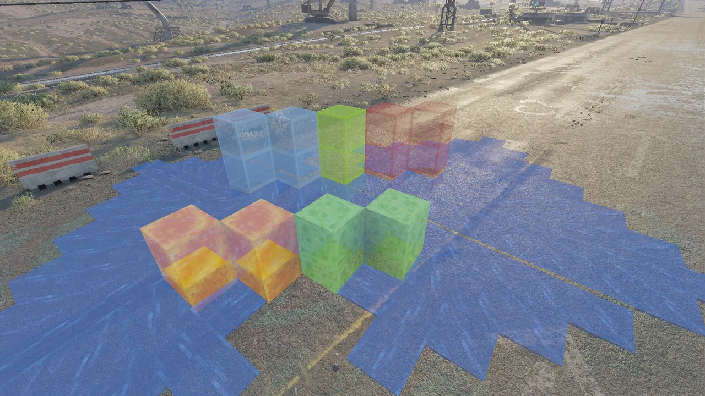
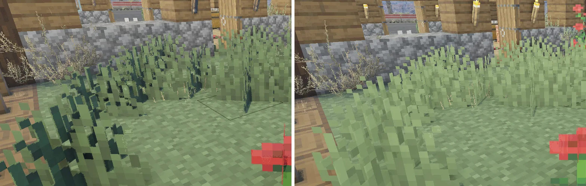
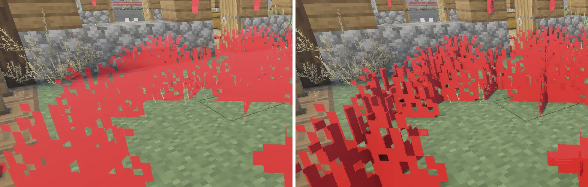

# Translucent blocks and dark grass: results

A polish pass, not a spike. Glass, slime, honey (and, it turned out, water, stained glass and ice) weren't drawn at
all, and Minecraft's grass and flowers looked very dark. Found with BlockRender 0.24.0 and fixed in 0.25.1
(`spikes/block-render/src/render/SectionParts.*`, the renderer's G-buffer and forward lists, `shaders/blocks.hlsl`).

## The answers

> Why don't glass, slime and honey render, when leaves do?

**Minecraft 26.3 puts them in its translucent layer, and BlockRender dropped that layer.** Minecraft picks a quad's
layer from its texture (`ChunkSectionLayer.byTransparency`): any texel between clear and opaque makes it
`TRANSLUCENT`. Slime, honey, water, ice and stained glass have only such texels (alpha 0.4 to 0.9). Glass has only
clear and opaque ones, as leaves do, but its model forces it (`"force_translucent": true` in `glass.json`). SkyCraft
marks those quads translucent, and BlockRender's section parser left translucent triangles out, as the first design
did (a G-buffer takes only opaque surfaces): 249,500 of them in one session of the user's.

**The fix** keeps them and splits each section into three parts as it's uploaded:
- **glass**, and any translucent triangle whose texels are all clear or opaque, goes into the G-buffer as a cut-out,
  with the other blocks, so the game lights it;
- **the rest** is blended into the scene's colour in the forward list, just before DLSS, as Minecraft's
  `translucent_terrain` blends it: source alpha, cut under 0.1, its depth written; sections farthest first. It's lit
  as the particles are, by Minecraft's light curve times `exposure` (2.5).

> Why does grass look so dark?

**The game lit it as a building, and buildings shadow themselves.** BlockRender drew every block with stencil class
0, the buildings'. A field of grass blades, dense in depth, shadowed and occluded itself almost black. The game's own
plants carry class 0xA0 (small plants) or 0xB6 (trees and bushes) and a higher material B, and are lit evenly.

**The fix:** plants (the quads SkyCraft sends with no direction, which Minecraft shades as if facing up: its cross,
tinted cross and crop models, vines, coral, seagrass, and a few thin things such as torches, ladders and fire) are
drawn with stencil 0xA0 and material B 0.75. `set plants 0` draws them as the blocks again; `set plantstencil` and
`set plantb` tune the two values.

## How it was found

Every test ran live, the agent sending requests and reading `dump color` (DLSS's input colour), the user standing
still in front of the blocks.

1. **`set gbdepth 0`** (blocks left out of the tagged depth): the grass blades brightened to the ground's level, but
   every block looked half-transparent. So the game's ambient occlusion and contact shadows read the tagged depth.
2. **0.25.0 kept plants out of the tagged depth until the forward list** and wrote their depth there for DLSS. The
   self-shadowing went, but the blades looked washed out. A test shader painting plants red showed why: they were
   solid, but lit as the surface behind them, the ground's shadows and the wall's ambient occlusion laid across them.
   **The game lights by the tagged depth**, so a surface left out of it is lit as what's behind it.

   

3. **Back in the tagged depth, with the game's plant classes:** `set stencil 160` with `set materialb 0.75`, then
   `set stencil 182`, both for every block: the blades were lit evenly and stayed solid, with either class. 0.25.1
   gives the small plants' class to plants alone and drops 0.25.0's depth pass.

## The checks

| Check | Build | Seen |
|---|---|---|
| Glass | 0.25.0 | a glass pane window: its frame lit as the planks beside it, the room seen through it |
| Water, slime, honey, stained glass, ice | 0.25.0 | the user's row on the road: all see-through, the Badlands behind them; slime and honey show their inner cube; water flows translucent; daylight brightness in keeping with the city |
| Grass and flowers | 0.25.1 | the user's field: blades solid and evenly lit, in front of the wall and the fence; no shadows from the ground on them |
| Cost | 0.25.1 | 66 frames drawn a second, none skipped; GPU 0.13 ms; the forward list 0.005 ms |
| Tests | 0.25.1 | 563, 7 new: the section split (`TestSectionParts.cpp`), the blended block shader, the status line |

## What's left

- **Translucent blocks at night:** they're lit by Minecraft's light, which doesn't follow the game's time of day, so
  they may look too bright at night. Not checked yet; `set exposure` tunes them with the particles.
- **No fog on translucent blocks,** which are drawn after it, as the particles are.
- **Sorting:** translucent sections are drawn farthest first, but the triangles inside a section in Minecraft's order,
  with their depth written. Two slime or stained glass blocks in one section can hide the one behind.
- **Thin things beside plants** (torches, lanterns, chains, ladders, redstone dust) take the small plants' class too.
  Nothing looked wrong on the torches in the dumps.
